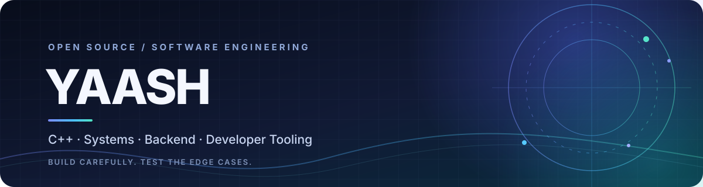

  
   
  
  
  
    
  

---

<h2 align="center">About Me</h2>

  I'm a BCA student and open-source contributor interested in systems software, backend reliability,
  reverse engineering, and developer tooling. I enjoy tracing bugs to their root cause, fixing edge cases,
  and writing regression tests that protect the behaviour of a project.

  <b>Currently exploring:</b> systems programming, Linux, cybersecurity, and AI/ML foundations. 
  <b>Beyond code:</b> music production and game technology.

<h2 align="center">Technologies & Tools</h2>

  
   
  
  
  

<h2 align="center">Selected Open-Source Contributions</h2>

<table>
  <tr>
    <td width="50%" valign="top">
      <h3>🎮 <a href="https://github.com/boykopovar/AnyPS5">AnyPS5</a></h3>
      
PS5 executable porting project. Worked on DirectMemory validation, relinker safety, and ABI evidence documentation.

      

        <a href="https://github.com/boykopovar/AnyPS5/pull/3870">#3870 · DirectMemory validation</a> 
        <a href="https://github.com/boykopovar/AnyPS5/pull/7822">#7822 · Relinker boundary safety</a> 
        <a href="https://github.com/boykopovar/AnyPS5/pull/10644">#10644 · ABI documentation</a>
      

    </td>
    <td width="50%" valign="top">
      <h3>🕹️ <a href="https://github.com/FelipePrado0/SpartanPort">SpartanPort</a></h3>
      
God of War III PC port. Contributed a shader-input guard and regression coverage for corrupt graphics-state recovery.

      

        <a href="https://github.com/FelipePrado0/SpartanPort/pull/398">#398 · Shader input guard</a> 
        <a href="https://github.com/FelipePrado0/SpartanPort/pull/135">#135 · State recovery tests</a>
      

    </td>
  </tr>
  <tr>
    <td width="50%" valign="top">
      <h3>🔎 <a href="https://github.com/morluto/rea">REA</a></h3>
      
Improved ADB shell-output parsing to make Android package and app-launch observations more accurate.

      
<a href="https://github.com/morluto/rea/pull/5001">#5001 · ADB parsing accuracy</a>

    </td>
    <td width="50%" valign="top">
      <h3>⚙️ <a href="https://github.com/vxcontrol/pentagi">PentAGI</a></h3>
      
Backend server lifecycle work focused on graceful HTTP shutdown and reliable cleanup ordering.

      
<a href="https://github.com/vxcontrol/pentagi/pull/476">#476 · Graceful server shutdown</a>

    </td>
  </tr>
</table>

<h2 align="center">Projects & Current Work</h2>

  
  

  Also contributing to <a href="https://github.com/pollen-robotics/microduck">microduck</a> and continuing work in
  <a href="https://github.com/morluto/rea">REA</a>. I keep open pull requests separate from merged contributions.

<h2 align="center">GitHub Overview</h2>

  
  
   
  

---

  
    
  <i>Build carefully. Test the edge cases. Leave the code better than you found it.</i>

