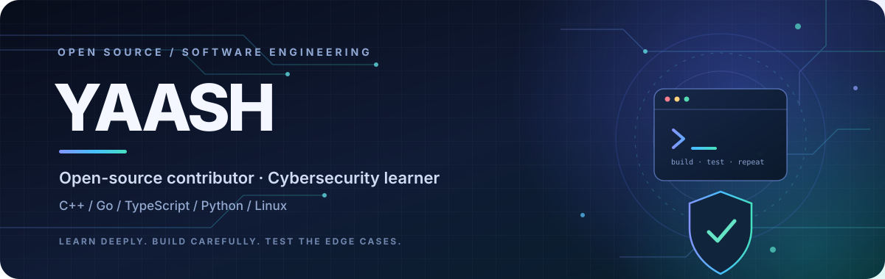

  

   

  
  
  

    

  

---

<h2 align="center">👋 Hey, I'm Yaash</h2>

  BCA student • Open-source contributor • Developer

  I enjoy understanding how software works beneath the surface. Most of my open-source work
  involves debugging real behaviour, fixing edge cases, improving reliability, and adding tests
  that stop regressions from coming back.

  <b>Current interests</b> 
  Cybersecurity · Systems programming · Backend engineering · Linux · AI/ML foundations

  <b>Outside development:</b> Music production and game technology 🎧

---

<h2 align="center">🧰 Tech Stack</h2>

  <h3>Languages & Development</h3>
  
    
  <h3>Tools & Environment</h3>
  

  
  
  
  

---

<h2 align="center">🚀 Open-Source Contributions</h2>

<table>
  <tr>
    <td width="50%" valign="top">
      <h3>🎮 <a href="https://github.com/boykopovar/AnyPS5">AnyPS5</a></h3>
      
PS5 executable porting project. Contributions across memory validation, relinker safety, and ABI documentation.

      <ul>
        <li><a href="https://github.com/boykopovar/AnyPS5/pull/3870">#3870 · DirectMemory validation and tests</a></li>
        <li><a href="https://github.com/boykopovar/AnyPS5/pull/7822">#7822 · Relinker rewrite boundary safety</a></li>
        <li><a href="https://github.com/boykopovar/AnyPS5/pull/10644">#10644 · ContentDelete ABI documentation</a></li>
      </ul>
    </td>
    <td width="50%" valign="top">
      <h3>🕹️ <a href="https://github.com/FelipePrado0/SpartanPort">SpartanPort</a></h3>
      
God of War III PC port. Contributions to shader input validation and graphics-state recovery testing.

      <ul>
        <li><a href="https://github.com/FelipePrado0/SpartanPort/pull/398">#398 · Empty shader input guard</a></li>
        <li><a href="https://github.com/FelipePrado0/SpartanPort/pull/135">#135 · Corrupt state recovery tests</a></li>
      </ul>
    </td>
  </tr>
  <tr>
    <td width="50%" valign="top">
      <h3>🔎 <a href="https://github.com/morluto/rea">REA</a></h3>
      
Android reverse-engineering toolkit. Improved ADB shell-output parsing accuracy.

      <ul>
        <li><a href="https://github.com/morluto/rea/pull/5001">#5001 · ADB shell parsing fix</a></li>
      </ul>
    </td>
    <td width="50%" valign="top">
      <h3>⚙️ <a href="https://github.com/vxcontrol/pentagi">PentAGI</a></h3>
      
AI agent platform. Working on graceful API server shutdown and lifecycle reliability.

      <ul>
        <li><a href="https://github.com/vxcontrol/pentagi/pull/476">#476 · Shutdown work (open PR)</a></li>
      </ul>
    </td>
  </tr>
</table>

  <b>Also working on:</b>
  <a href="https://github.com/pollen-robotics/microduck">microduck</a> ·
  <a href="https://github.com/morluto/rea">REA</a>

  Merged contributions are listed separately from work that is still under review.

---

<h2 align="center">📌 Featured Projects</h2>

  
  

---

<h2 align="center">📊 GitHub Stats</h2>

  
  
    
  

---

<h2 align="center">🤝 Let's Connect</h2>

  
  
    
  
    
  <i>Stay curious. Understand the details. Make every change count.</i>

